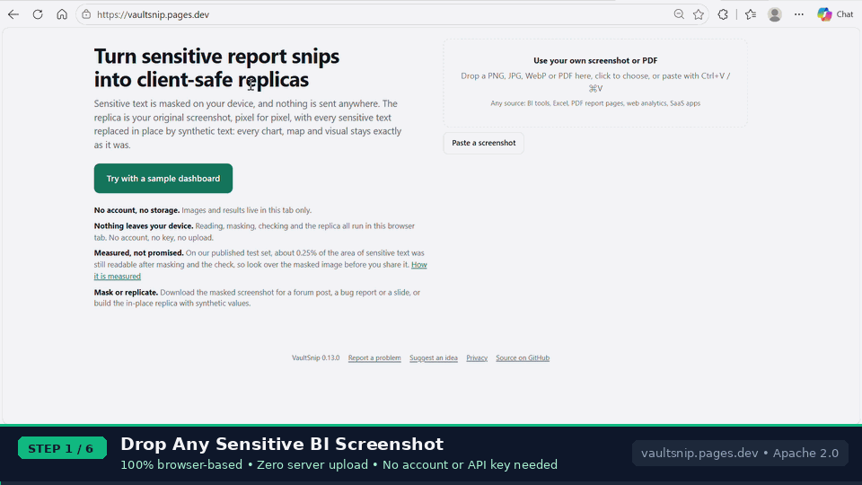

# VaultSnip

[](https://github.com/karthikvalluri85/vaultsnip/actions/workflows/ci.yml)
[](https://vaultsnip.pages.dev)
[](LICENSE)
[](CHANGELOG.md)

**Turn sensitive report snips into client-safe replicas.**

**Try it now:** https://vaultsnip.pages.dev (no sign-up, no key, nothing uploaded)  
Also on Hugging Face: https://huggingface.co/spaces/karthikvalluri/vaultsnip · Chrome and Edge store listings are in review.

VaultSnip takes a screenshot of any dashboard or report (BI tools, Excel, PDF report pages, product analytics, SaaS apps), finds and masks sensitive text **on your device**, sends nothing anywhere, and gives you back **the same screenshot with every sensitive text replaced in place by synthetic text**: every chart, map and visual keeps its original pixels, and only the hidden text changes. Nothing is stored.

**What it does not hide on its own:** only text is replaced. Chart shapes (bar lengths, line trends, slice sizes, map shading) stay the real ones, and the review screen says so. If a trend is itself confidential, choose **Blur a chart** and drag over it, or **Blur all charts**.

**How safe it is, measured:** on 20 generated dashboards with known sensitive words (seed 3, reproducible with `npm run bench`), **0.25% of the area of sensitive text was still readable** after masking and the pre-flight check, and **5 of 1,780 upright sensitive words had more than 15% of their letters uncovered** (2 numbers in part, a one-letter initial, a sliver of a product name and one organisation the reader never saw). That is why the review screen asks you to look before you share. Details and how to reproduce it: [ACCURACY.md](ACCURACY.md#where-it-stands-in-013). To measure on your own screenshots, privately: `npm run bench:real:label`.

```
capture → local OCR → mask everything except an allowlist → independent re-scan gate
        → you look over the masked image → synthetic text for each hidden box, made on your device
        → in-place replica: hidden text wiped from the background around it and redrawn in the same place, size and colour
        → hover a replaced value to see what it stands for → download or copy the PNG
```

## See it in action



*VaultSnip 0.13 on the bundled fictional sample.*

## Features

| Area | Status |
|---|---|
| Sample on screen 1 | ✅ runs the full demo on a fictional dashboard: OCR, masking, check, in-place replica |
| Upload, paste (on any screen, or with the Paste button), extension snip with crop | ✅ |
| Local OCR (Tesseract.js, WASM) | ✅ normal, inverted, high-contrast and block passes; implausible "words" from chart shapes are ignored; very large screenshots are read at up to 9 megapixels, and the review says when one was shrunk |
| Language | English dashboards. Text in other languages is read as English, so its words are masked as unknown: more is hidden than needed, never less |
| Mask by default, allowlist to keep | ✅ client names, IDs, emails and unlisted text are masked; numbers are replaced with invented values of the same size (or masked, if you prefer) |
| Blur text in charts on any page (extension) | ✅ right-click → "Blur text in charts on this page" or Alt+Shift+B: charts drawn on canvas (Power BI, Tableau, ECharts…) are read on your device and sensitive text is blurred in place; run again to remove |
| On-device name check (AI) | ✅ a 19 MB PII model in a Web Worker masks safe words used as names ("May Chen", "Delta Airlines"); only adds masks; can be switched off |
| Unread-text check (AI) | ✅ two small PP-OCRv5 models (5 MB and 7 MB) find every patch of text and read it again line by line, and mask any the reader missed or could not vouch for; only adds masks; can be switched off |
| Independent re-scan gate (Nothing found / Review / Blocked) | ✅ six independent re-reads of the masked image, plus one-click **Hide everything uncertain**; each finding shows a close-up of the image as it would be shared, likely leaks first and probable chart marks last, and M / K step through them from the keyboard; digits read from chart shapes where no text was found are set aside (counted, and shown on request) |
| Review: click to toggle, drag to add masks | ✅ |
| **Blur a chart** | ✅ drag over any chart whose shape is confidential: it becomes a soft wash of its own colours in the masked image and the replica, so bar lengths, trends and proportions cannot be read; click it to undo; the receipt counts blurred areas. **Blur all charts** finds every chart on the device (by its colours, or for charts in greys by how they stand out from their panel) and blurs them in one click |
| Customer comments: keep the wording of verbatims, mask the names, emails and numbers inside them | ✅ opt-in |
| Preview of the masked image before you save, copy or build | ✅ |
| **In-place replica** | ✅ the original screenshot, pixel for pixel, with each hidden text wiped from its surrounding background (only the text's own pixels; bar edges and borders through a box survive) and synthetic text drawn back in the same place, size, colour, weight and alignment. Any visual works, because none is redrawn: decomposition trees, custom maps, proprietary widgets |
| **Hover explanations** | ✅ an invisible layer over the picture, aligned to its pixels at every size: hover or tab to a replaced value to see its kind, the labels beside it and where it came from; never the hidden text |
| Synthetic text **made on this device** | ✅ numbers of the same size (axis ticks on an even new scale), dates in their own format all moved by the same made-up months (an axis of dates stays in order, slanted labels included), made-up people, companies and IDs (Faker), emails only at example.com/.net/.org |
| **Download / Copy image** of the replica | ✅ PNG with a strip below the picture saying its text is synthetic |
| **Mask-only download** | ✅ masked PNG for forums, bug reports and slides, or **Copy masked image** to paste it anywhere |
| **Safe-to-share receipt** | ✅ PNG or PDF beside the masked image: what was hidden (counts and kinds, never the text), the check, made on this device, and the image's SHA-256 |
| Chrome/Edge extension (MV3, `activeTab` only) | ✅ model downloaded on first launch, cached in IndexedDB |
| In-app feedback with a private route for masking misses | ✅ |
| **PDF input** | ✅ drop or pick a PDF; multi-page PDFs ask which page; the PDF reader (PDF.js) is bundled and loads on demand |
| **Batch masking** | ✅ queue screenshots and PDFs (every page, up to 30 a file) under one policy; each image runs the full six-pass check and only images that pass go in the ZIP, each with its receipt; the rest are held back for review |
| **Per-client allowlist profiles** | ✅ save and reload named redaction policies (stored in your browser only) |
| Visual fingerprint warning | ✅ flags a logo or picture in a top corner, or a header in strong brand colours, left after masking |

## Privacy

Nothing leaves your device. OCR, masking, the six-pass safety gate, and the in-place replica all run in your browser tab. No backend, no database, no accounts, no analytics, and no AI service. Images, OCR text and results live in the tab's memory only. The browser stores only the app's model files, and your saved policies if you choose to save them (a policy's name and its safe words, in this browser only). See [PRIVACY.md](PRIVACY.md).

Enterprise and self-hosting: [ENTERPRISE.md](ENTERPRISE.md).

## Feedback and support

- **In the app:** click **Feedback** (top right) or **Report a problem** (footer). Errors also offer **Report this**. Your report opens on GitHub, pre-filled with the version, browser and step, and never includes your screenshot or dashboard text. No GitHub account? Choose **Email instead**.
- **Bugs:** [open a bug report](https://github.com/karthikvalluri85/vaultsnip/issues/new?template=bug_report.yml) · **Replica problems:** [open a replica report](https://github.com/karthikvalluri85/vaultsnip/issues/new?template=replica.yml)
- **Ideas and questions:** [Discussions](https://github.com/karthikvalluri85/vaultsnip/discussions)
- **Sensitive text left unmasked:** report it **privately**, see [SECURITY.md](SECURITY.md)

More in [SUPPORT.md](SUPPORT.md).

## Run it locally

```bash
cd web
python3 -m http.server 8080      # or: npx serve .
```

Open http://localhost:8080 and click **Try with sample dashboards**. Opening `index.html` directly as a file won't work, because the OCR engine needs http.

## Load the extension (Chrome or Edge)

```bash
./build.sh --bundle-models        # model packed inside the extension (local testing and store uploads)
```

1. Open `chrome://extensions` (or `edge://extensions`) and switch on **Developer mode**.
2. **Load unpacked** → choose `dist/extension`.
3. Open any dashboard tab, click the VaultSnip toolbar icon, drag over the area, and go.
4. To blur sensitive text inside the page's charts without leaving it, right-click → **Blur text in charts on this page** (or Alt+Shift+B). Run it again to remove the blur.

Use the same `--bundle-models` build for the Chrome Web Store and Edge Add-ons: the OCR and on-device AI models ship inside the extension (about 42 MB zipped, uncompressed inside because the Edge store refuses compressed files), so it works offline and makes no network request at all. Tagged releases attach ready-made packages automatically.

## Deploy

- **Web app:** Cloudflare Pages, connected to this repo. Build command: none. Output directory: `web`. Every push to `main` deploys.
- **Hugging Face Space:** a *Static* Space with the two files in `dist/hf-space` (`README.md` and a page that shows the live web app), so it always runs the latest release. Live at https://huggingface.co/spaces/karthikvalluri/vaultsnip.
- **Chrome Web Store / Edge Add-ons:** run `./build.sh --bundle-models`, then upload `dist/vaultsnip-extension.zip`; listing text, permission justifications and privacy answers in [STORE_LISTING.md](STORE_LISTING.md), privacy disclosures in [PRIVACY.md](PRIVACY.md).

## Project layout

```
web/              the app (static, no build step), published as-is
  index.html      screens and styles
  app.js          pipeline: OCR, masking, gate, review, payload preview, replica screen
  inpaint.js      in-place replica: background sampling, pixel clearing, text redraw, hover layer
  synth.js        synthetic text for each hidden box, made on the device
  feedback.js     in-app feedback and error reporting
  samples.js      bundled fictional sample
  lib/ lang/      tesseract.js + OCR model, vs-context.js (on-device AI client), vs-faker.js (made-up names)
  ml/ models/     on-device AI: Web Worker + ONNX runtime (npm run build:ml), PII and text-region models (npm run fetch:model)
extension/        manifest.json; background.js, canvas-ocr.js, offscreen.*, wasm/ built from src/ (npm run build:ext)
src/              TypeScript sources: name check, chart blur (background/, content/), made-up names (replica/)
tools/            check.mjs, e2e.mjs, build scripts, synth-bench/ (masking benchmark), inplace-bench/ (replica benchmark)
build.sh          builds dist/web, dist/extension, dist/hf-space and zips
.github/media/    the README's demo recording (not shipped in the app or the extension)
```

## Contributing

Contributions are welcome. Please read [CONTRIBUTING.md](CONTRIBUTING.md) and the [code of conduct](CODE_OF_CONDUCT.md). In short: no real data anywhere, no new data flows, and `npm run check`, `npm run test:unit`, `npm run e2e` and `npm run test:inplace` must pass. Changes are listed in [CHANGELOG.md](CHANGELOG.md). How accuracy is measured, today's figures and the plan for raising them are in [ACCURACY.md](ACCURACY.md).

## License

[Apache License 2.0](LICENSE) © 2026 Karthik Valluri. Third-party components are listed in [THIRD_PARTY_NOTICES.md](THIRD_PARTY_NOTICES.md).
